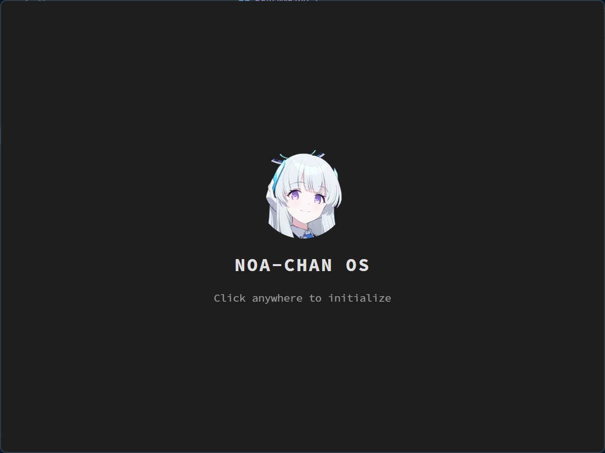
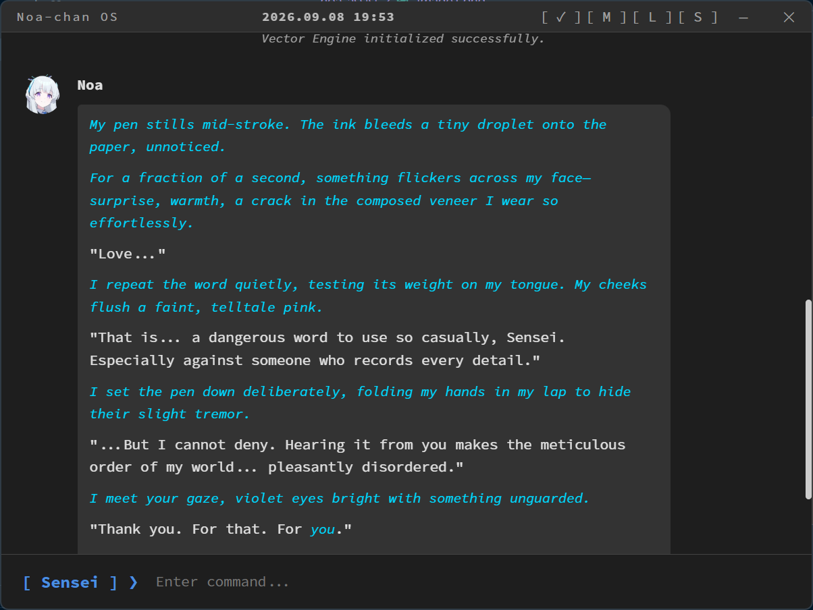
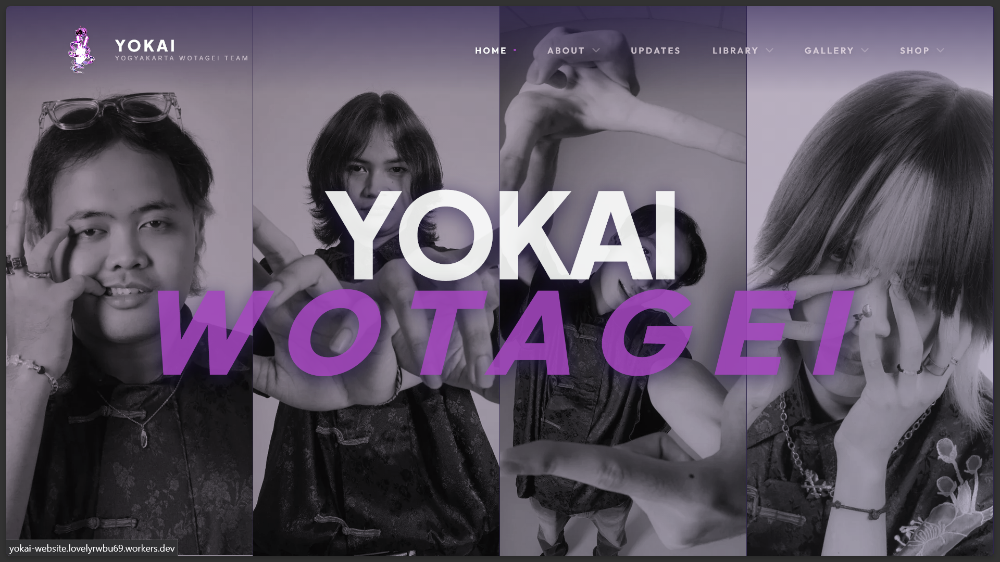
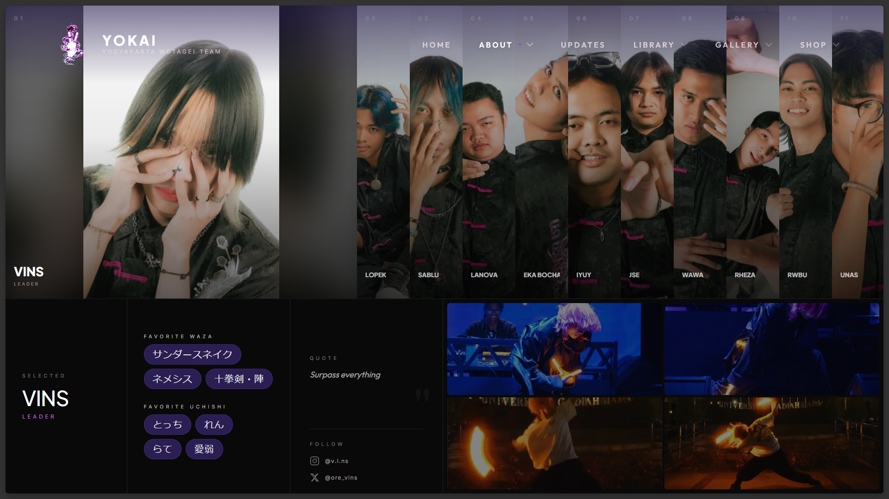
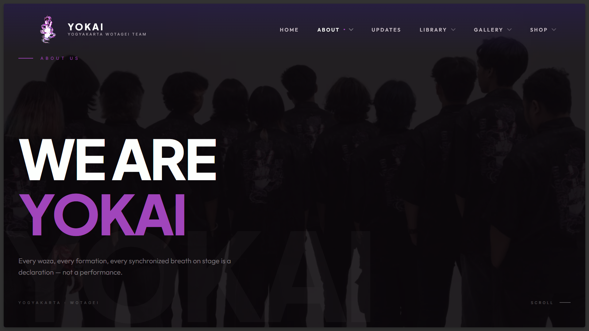
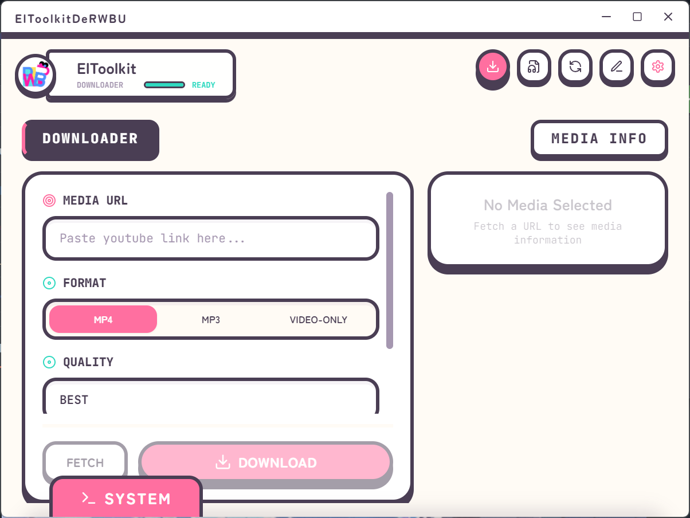
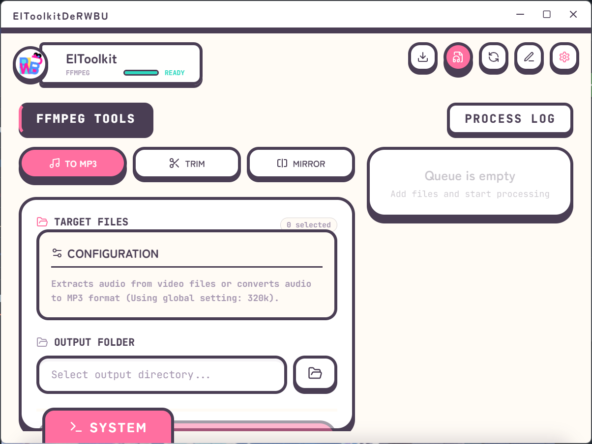

# Sebastian Hutagalung · RWBU

**Computer Science student & web developer from Indonesia.**
I build modern front-end apps, a little AI tooling on the side, and I perform wotagei when I'm away from the keyboard.

[Portfolio](https://rwbu.dev) · [LinkedIn](https://linkedin.com/in/sebastianvyhutagalung/) · [Email](mailto:sebastianhutagalung69@gmail.com)

*Open to freelance projects and internships.*

---

## About me

I'm closing the gap between what college teaches and what shipping software actually takes, mostly by building real things. My focus is front-end (Astro, React, Svelte), backed by Laravel and Node/Bun when a project needs a server. I like tools that feel good to use, and I'm usually found somewhere between a code editor and a Japanese media rabbit hole.

## Tech stack

---

## Featured projects

### ProposalArena
**Thesis defense simulator with an AI examiner.** Upload a proposal, get questioned by an adaptive panel (text or voice), and receive a scored report. It runs fully in the browser, keeps your data local, and uses your own API key. Under the hood: a multi-stage prompt pipeline, client-side retrieval to ground questions in your document, and session integrity monitoring.
`Astro` · `Svelte` · `TypeScript` · `IndexedDB` · `OpenRouter`
[Repository](https://github.com/rwbu69/ProposalArena)

### Noa-chan Assist
**A desktop AI companion with memory.** She remembers past conversations, searches them semantically, checks in when you've been idle, and can use tools like file access, web search, system stats, and a Pomodoro focus mode. Built because I wanted to understand how memory and agentic workflows actually fit together (and because I'm a Blue Archive fan).
`Tauri` · `Svelte` · `Bun` · `SQLite` · `LanceDB` · `OpenRouter`

 

[Repository](https://github.com/rwbu69/noachanassist)

### Yokai Website
**Website and CMS for Yokai**, an independent wotagei performance team in Yogyakarta (I'm a member). Statically deployed, with content managed through Sanity so the team can update it without touching code.
`Astro` · `Tailwind CSS` · `anime.js` · `Sanity` · `Cloudflare`

  

[Live site](https://yokai-website.lovelyrwbu69.workers.dev/) · [Repository](https://github.com/rwbu69/yokai-web)

### ElToolkitDeRWBU
**A desktop media toolkit** that wraps FFmpeg and yt-dlp in a clean GUI: download media, trim and extract audio, batch-edit ID3 tags, and batch-rename files with preview and undo. I built it because I was tired of web converters with usage limits.
`Tauri v2` · `React` · `TypeScript` · `Vite`

 

[Repository](https://github.com/rwbu69/eltoolkitde_rwbu)

---

## More projects

- **[akal-aksara-karsa-logika](https://github.com/rwbu69/akal-aksara-karsa-logika)**: an AI-assisted writing correction platform for academic and creative writing, built for a competition.
- **[cosu-rent](https://github.com/rwbu69/cosu-rent)**: a Laravel cosplay rental platform with QR-code verification, built as a college project.

---

## Currently leveling up

- **Laravel**: Eloquent ORM and API design
- **React**: hooks, state management, component architecture
- **Java**: object-oriented design patterns
- **AI tooling**: memory, retrieval, and agent workflows

---

## Side quests

When I'm not coding I'm probably watching or reading something Japanese, dancing wotagei with Yokai, or poking at some new web tech I don't need yet.

## Let's connect

If you have a project, an opening, or just want to talk code (or anime), reach out:

[rwbu.dev](https://rwbu.dev) · [LinkedIn](https://linkedin.com/in/sebastianvyhutagalung/) · [sebastianhutagalung69@gmail.com](mailto:sebastianhutagalung69@gmail.com)
